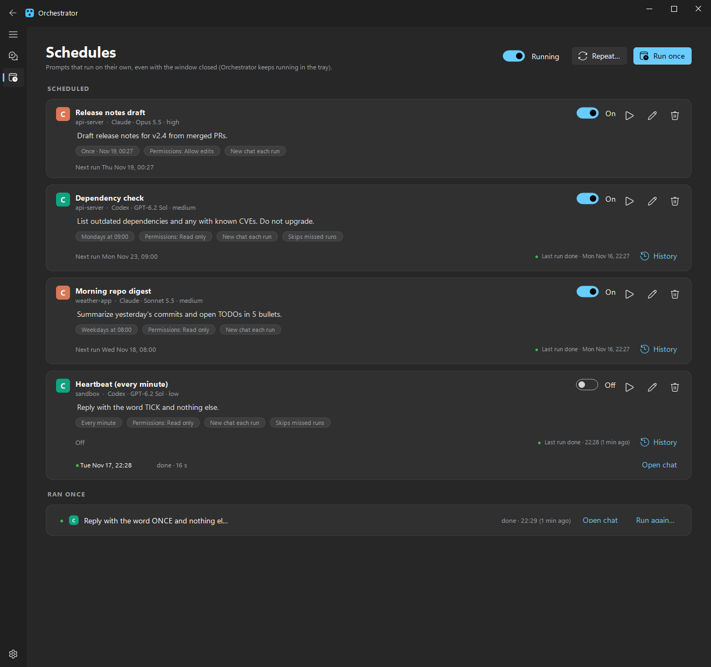

# Orchestrator

Windows desktop app (PySide6 + Fluent widgets) that drives **Claude Code** and **Codex** from one window.
See [docs/PLAN.md](docs/PLAN.md) for the roadmap and [M0_NOTES.md](M0_NOTES.md) for engine details.


## Status: M1 (MVP chat app)

- Projects are folders on disk. Chats live under each project in the left sidebar, with status dots.
- One pill picks the engine, model and reasoning effort, for example "Codex · GPT-6.2 Sol · medium".
  You can edit the model list in Settings › Models.
- Replies stream in with markdown, highlighted code blocks with a copy button, and collapsible tool-call cards.
  There is also a stop button, and each turn shows its token use.
- Follow-up messages resume the same engine session: Codex by `thread_id`, Claude by `session_id`.
- Claude asks before it runs a tool, with Allow / Deny inline in the chat.
- Data is stored in SQLite at `%APPDATA%\Orchestrator\orchestrator.db`. Tokens are kept only in Windows Credential Manager (keyring).

## M2: import and resume


- Orchestrator reads, but never changes, the engines' own logs: `~/.claude/projects/*/*.jsonl` and `~/.codex/sessions/**`.
  Codex titles come from `~/.codex/session_index.jsonl`. Claude titles come from `custom-title` lines, or else the first prompt.
  Codex sub-agent threads and scratch folders under `%TEMP%` are skipped.
- It checks for changes every 8 s. Only changed files are parsed again, in a worker thread.
- Sessions go under the project whose folder contains their working folder. Other folders are listed under
  "Discovered in engine history"; adding the folder as a project moves them up.
- Each chat row shows a status dot (it pulses while running), the engine badge and the age.
- Opening an imported chat shows its history from the engine log. Typing continues the same engine session.
- Several chats can run at once. You can switch between them while they stream, and their live state is restored.
- Deleting an imported chat hides it in Orchestrator; the engine's log is kept.

## M3: tray and schedules



- **Run once** is the main action. It's on the Schedules page, and the clock button next to Send in every chat opens it.
  A small popover holds the prompt (prefilled from your draft), time chips (In 15 min, In 1 hour, Tonight 9 PM,
  Tomorrow 8 AM, Custom…), and engine/model/effort, which default to the current chat. You can continue that chat or start a new one.
  After a one-shot job runs, it moves to the "Ran once" history, where you can open the chat or run it again.
- **Repeat…** creates recurring schedules: presets (every hour, weekdays at 08:00…) or any 5-field cron, with a live
  preview of the next run. Every schedule has Run now, Edit, an On/Off toggle, its next run time and run history with links to the chats.
- Schedules are kept by APScheduler (AsyncIOScheduler + a SQLite job store, `%APPDATA%\Orchestrator\jobs.db`).
  Missed runs, for example while the PC slept, either run once when the PC is back or are skipped, set per schedule.
  A 30 s heartbeat makes sure runs that came due during sleep are noticed after wake.
- Unattended runs follow a permission policy chosen per schedule. **Read only** is the default; Allow edits and Full access are also available.
  Tool requests outside the policy are denied automatically, and the chat records each one.
- Tray icon: a badge shows how many jobs are running. The menu has Open, Pause schedules and Quit. Closing the window keeps the app in the tray.
  Windows notifications appear when a chat or schedule finishes or fails, or when a chat needs your input; clicking one opens the chat.
- Settings › Background: keep running in the tray, notifications, and start at login (off by default; uses
  `HKCU\...\Run` → `pythonw run.py --tray`).

## Run

```
python -m venv .venv
.venv\Scripts\pip install -r requirements.txt
.venv\Scripts\python run.py
```

Or double-click `Orchestrator.cmd` (no console window).

Engines must be installed and signed in:

- Codex: `npm i -g @openai/codex`, then `codex login`.
- Claude: run `claude setup-token`, then paste the token in Settings › Accounts or set `CLAUDE_CODE_OAUTH_TOKEN`.
  The app looks for the token in this order: keyring, the process environment, then `HKCU\Environment`.

## Tests

```
.venv\Scripts\python -m pytest -q                                   # adapter parsing, storage, markdown
.venv\Scripts\python scripts\ui_smoke.py --engine codex --rich --shot docs\screenshots\m1.png
.venv\Scripts\python scripts\ui_smoke_m2.py real                    # import + resume + 2 chats at once
.venv\Scripts\python scripts\ui_smoke_m2.py demo --shot docs\screenshots\m2.png
.venv\Scripts\python scripts\ui_smoke_m3.py --shot docs\screenshots\m3.png   # real 1-minute schedule + run once
```

`ui_smoke.py` opens the real window and runs a live chat against a throwaway data folder: a new turn, a resume, and a tool turn.
