# Orchestrator

Windows desktop app (PySide6 + Fluent widgets) that drives **Claude Code** and **Codex** from one window.
See [docs/PLAN.md](docs/PLAN.md) for the roadmap and [M0_NOTES.md](M0_NOTES.md) for engine details.

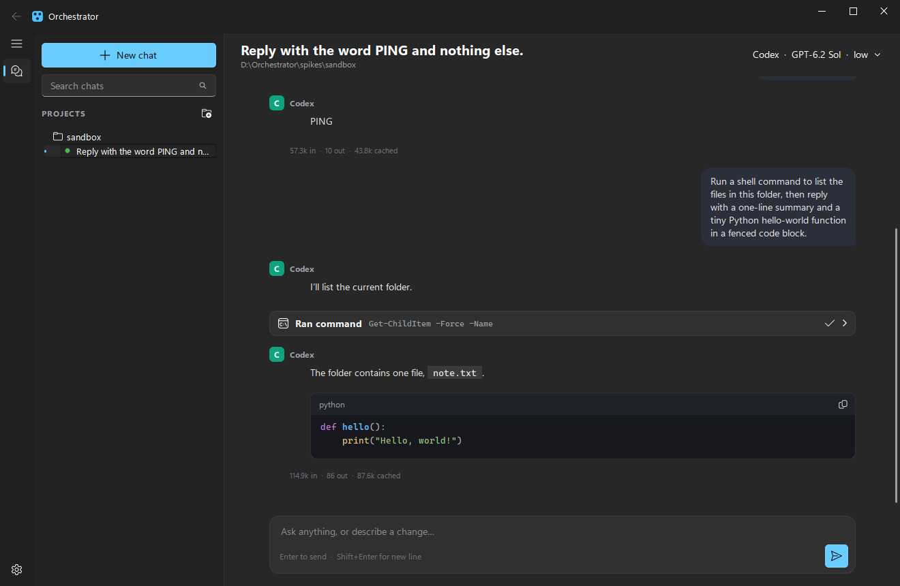

## Status: M1 (MVP chat app)

- Projects are folders on disk. Chats live under each project in the left sidebar, with status dots.
- One pill picks the engine, model and reasoning effort, for example "Codex · GPT-6.2 Sol · medium".
  You can edit the model list in Settings › Models.
- Replies stream in with markdown, highlighted code blocks with a copy button, and collapsible tool-call cards.
  There is also a stop button, and each turn shows its token use.
- Follow-up messages resume the same engine session: Codex by `thread_id`, Claude by `session_id`.
- Claude asks before it runs a tool, with Allow / Deny inline in the chat.
- Data is stored in SQLite at `%APPDATA%\Orchestrator\orchestrator.db`. Tokens are kept only in Windows Credential Manager (keyring).

## M2: import and resume

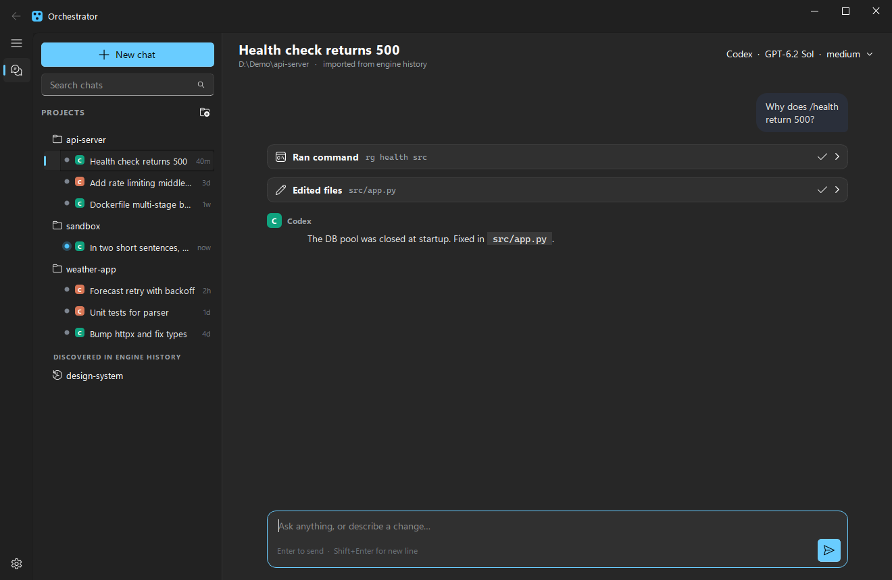

- Orchestrator reads, but never changes, the engines' own logs: `~/.claude/projects/*/*.jsonl` and `~/.codex/sessions/**`.
  Codex titles come from `~/.codex/session_index.jsonl`. Claude titles come from `custom-title` lines, or else the first prompt.
  Codex sub-agent threads and scratch folders under `%TEMP%` are skipped.
- It checks for changes every 8 s. Only changed files are parsed again, in a worker thread.
- Sessions go under the project whose folder contains their working folder. Other folders are listed under
  "Discovered in engine history"; adding the folder as a project moves them up.
- Each chat row shows a status dot (it pulses while running), the engine badge and the age.
- Opening an imported chat shows its history from the engine log. Typing continues the same engine session.
- Several chats can run at once. You can switch between them while they stream, and their live state is restored.
- Deleting an imported chat hides it in Orchestrator; the engine's log is kept.

## M3: tray and schedules


- **Run once** is the main action. It's on the Schedules page, and the clock button next to Send in every chat opens it.
  A small popover holds the prompt (prefilled from your draft), time chips (In 15 min, In 1 hour, Tonight 9 PM,
  Tomorrow 8 AM, Custom…), and engine/model/effort, which default to the current chat. You can continue that chat or start a new one.
  After a one-shot job runs, it moves to the "Ran once" history, where you can open the chat or run it again.
- **Repeat…** creates recurring schedules: presets (every hour, weekdays at 08:00…) or any 5-field cron, with a live
  preview of the next run. Every schedule has Run now, Edit, an On/Off toggle, its next run time and run history with links to the chats.
- Schedules are kept by APScheduler (AsyncIOScheduler + a SQLite job store, `%APPDATA%\Orchestrator\jobs.db`).
  Missed runs, for example while the PC slept, either run once when the PC is back or are skipped, set per schedule.
  A 30 s heartbeat makes sure runs that came due during sleep are noticed after wake.
- Unattended runs follow a permission policy chosen per schedule. **Read only** is the default; Allow edits and Full access are also available.
  Tool requests outside the policy are denied automatically, and the chat records each one.
- Tray icon: a badge shows how many jobs are running. The menu has Open, Pause schedules and Quit. Closing the window keeps the app in the tray.
  Windows notifications appear when a chat or schedule finishes or fails, or when a chat needs your input; clicking one opens the chat.
- Settings › Background: keep running in the tray, notifications, and start at login (off by default; uses
  `HKCU\...\Run` → `pythonw run.py --tray`).

## Projects home

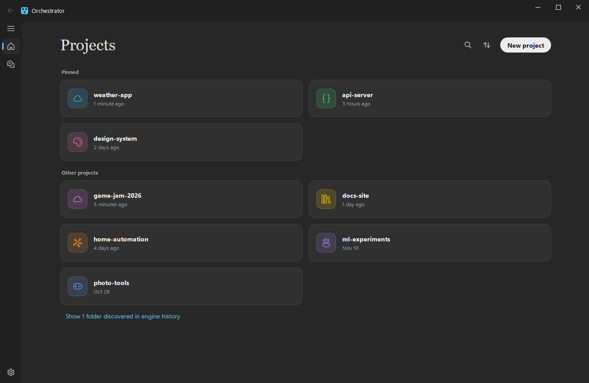

- The app opens on **Projects**: Pinned and Other projects in a two-column card grid (one column when the window is narrow).
  Each card shows the project's icon tile, name and last activity ("1 minute ago", "2 days ago", then "Nov 10").
- Top right: search, sort (recent activity, name, created) and **New project**. Clicking a card opens that project's chats.
- Right-click or ⋯ on a card: Pin/Unpin, Rename, Customize icon (icon + color), Open folder, Remove.
  Pinned state, icon and color are stored in SQLite. Folders found only in engine history stay behind a "Show N folders…" link.

## M4: orchestrator

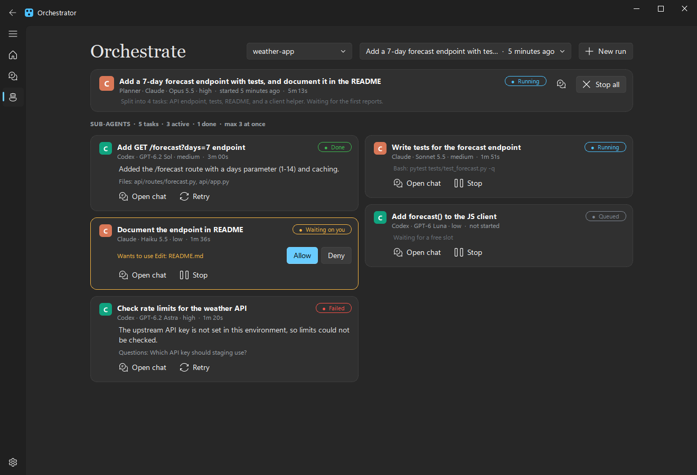

- **Orchestrate** page: pick a project, write a goal, choose the planner's engine/model/effort (Claude or Codex)
  and max parallel sub-agents (default 4), then Start. The planner is an ordinary chat that splits the goal into
  tasks and runs sub-agents, which can be Claude or Codex, any enabled model.
- The planner's tools come from a local stdio MCP server, `python -m orchestrator.mcp_server`, which the engine starts.
  It forwards each call over a 127.0.0.1 socket with a per-run secret to the app, which owns the tasks:
  - `delegate(instructions, engine?, model?, effort?, title?, cwd?, resume_session_id?)` returns a task id right away.
    Disabled or unknown models are refused with a clear error.
  - `task_status(task_id?)` returns one task or all of them.
  - `wait_for(task_ids, timeout)` blocks for up to 4 minutes per call, under the 10-minute tool timeout. If tasks are
    still running, it returns `done: false` with `pending` ids, and the planner calls it again.
  - `send_to_task(task_id, text)` sends a follow-up in the same sub-agent chat.
  - Claude gets the server through the Agent SDK `mcp_servers` option. Codex gets it through `-c mcp_servers.orchestrator.*`
    overrides, with `default_tools_approval_mode='approve'`. Both are tested end to end (`scripts/e2e_m4.py claude|codex`).
- Each sub-agent's prompt ends with a closing instruction to write a ```` ```report ```` block (status, summary,
  files changed, open questions). The app parses the block, adds any edited files it saw in tool calls, and returns
  the result to the planner as the `wait_for` result. If the report is missing, the result is built from the last reply.
- Live board: one card per sub-agent, showing engine badge, model and effort, status (queued / running /
  waiting on you / done / failed / stopped), elapsed time and last output line, plus Open chat, Stop and Retry buttons.
  Stop all ends the planner and every task.
  When a sub-agent asks for approval, its card shows Allow/Deny and the tray notifies you.
- Sub-agents run in the project folder (Claude in accept-edits mode, Codex in workspace-write). Their chats appear
  in the sidebar nested under the planner chat.
- **Git worktree per task** (off by default): when two sub-agents would write in the same git repo at once, the
  later one gets its own worktree under `%APPDATA%\Orchestrator\worktrees` on branch `orchestrator/task-N`.
  Its report includes the path and branch.

## M5: reuse and auto routing

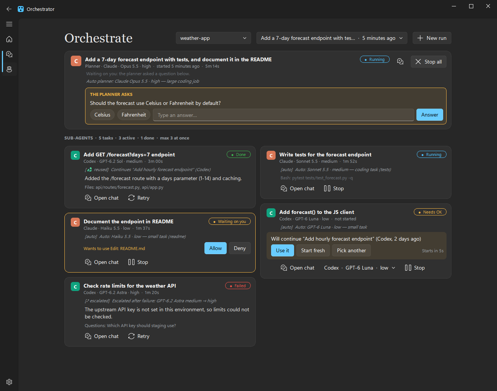

- **Session summaries:** when a chat goes idle, the cheapest enabled model (Haiku, Luna, and so on) writes a 3 to 5 line
  summary plus keywords. The call is one-shot, runs in the app's scratch folder and never appears as a chat.
  Settings › Orchestrator › Session summaries can switch this to a quick heuristic (no model) or off.
- **`find_sessions(query)`** ranks earlier chats from both engines by keyword match (title > keywords > summary),
  same project and recency, and explains each match ("matches 'login'; same project; 2 days ago").
- **Reuse card:** when the planner passes `resume_session_id` (a `session_ref` like `s:12`) to `delegate`, the
  task card shows "Will continue *Fix login bug* (Codex, 2 days ago)" with **Use it**, **Start fresh** and
  **Pick another** (choose from the other matches). By default it accepts after a 10 s countdown; Settings can
  make it always ask or never ask. A reused chat keeps its engine and gets only the new task, without the intro.
- **Auto model and effort:** if the planner leaves engine, model and effort empty, the app picks them from
  enabled models only. Hard tasks (debugging, architecture) go to the strongest Claude model on high, large
  coding jobs to Codex on high, and small tasks to the cheapest model on low. Each card shows its reason,
  e.g. "Auto: Haiku 5.5 · low — small task (readme)". Planners that choose for themselves follow the editable
  routing guide (Settings › Orchestrator) and pass `reason`. A queued card has a model picker to change the
  choice before it starts. With "Always ask", every automatic pick waits for your OK.
- **Auto planner:** tick **Auto** next to the planner picker and the app picks the planner's engine and strength
  from the goal. The pick and its reason show at the top of the board.
- **Escalate once:** if a task on an automatic pick fails, the app retries it once in the same chat, first with more
  effort and then with the next stronger enabled model. The card shows "Escalated after failure: …".
- **`ask_user(question, options)`:** the question appears on the board with option buttons and an answer box, and
  the tray notifies you. Each call waits up to 4 minutes; if there is no answer yet, the planner calls again with
  the `question_id`.
- `send_to_task(task_id, text)` sends a follow-up to a finished sub-agent in the same chat.
- Real end-to-end check with both planners: `scripts/e2e_m5.py claude|codex`.

## M6: polish

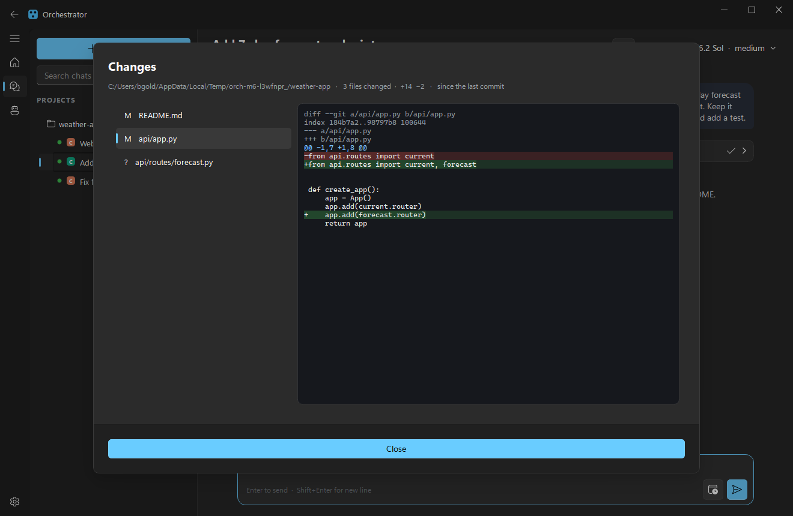

- **Diff viewer:** the page button in a chat's header (or **Ctrl+D**) shows what changed in that chat's folder since
  the last commit: a list of changed and new files with a colored unified diff, plus the counts (files, +lines, −lines).
  Each sub-agent card on the board has a **Changes** button for its folder (or its worktree).
- **Usage meter:** the chat header shows the tokens that chat has used in Orchestrator, e.g. "59.4k in · 2.3k out",
  plus cost when the engine reports it (Claude does). Task cards show per-task usage, and the planner strip shows
  the run total.
- **Search across chats:** **Ctrl+K** opens a palette that searches titles, summaries and message text of every chat.
  Use ↑↓ and Enter to jump to a chat.
- **Keyboard shortcuts** (**F1** lists them): Ctrl+K search, Ctrl+N new chat, Ctrl+L focus the message box,
  Ctrl+. stop, Ctrl+D changes, Ctrl+1…4 pages, Ctrl+, settings.
- **Windows build:** `powershell -ExecutionPolicy Bypass -File scripts\build.ps1` builds
  `dist\Orchestrator\Orchestrator.exe` (one folder, windowed, includes the Claude Code CLI that ships with the
  Agent SDK) and `dist\Orchestrator-<version>-win64.zip`. If Inno Setup 6 is installed, it also builds a per-user
  installer from `installer\orchestrator.iss`. The exe also serves as the orchestrator MCP server
  (`Orchestrator.exe --mcp-server`), so the built app needs no Python. Codex still comes from your own
  `codex` install on PATH.

## Schedules: readable buttons, easy times

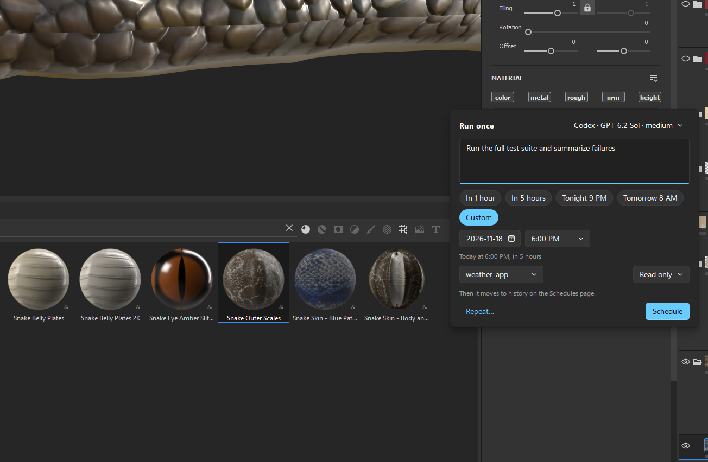

- Buttons keep their full labels at any width; on a narrow window the Schedules header puts its controls on a
  second row, chips wrap, and the page never scrolls sideways. The Run once popover stays inside the window.
- Picking a time: chips **In 1 hour**, **In 5 hours** (default), **Tonight 9 PM**, **Tomorrow 8 AM**, or **Custom**
  (calendar + a 15-minute time list instead of spin boxes). The choice is read back in words, e.g.
  "Today at 6:30 PM, in 5 hours"; next runs on the cards read the same way. Used by Run once, the schedule
  dialog's Once mode and orchestrations' Run once later.

## Orchestrate: clearer setup, queue and project auto-pick

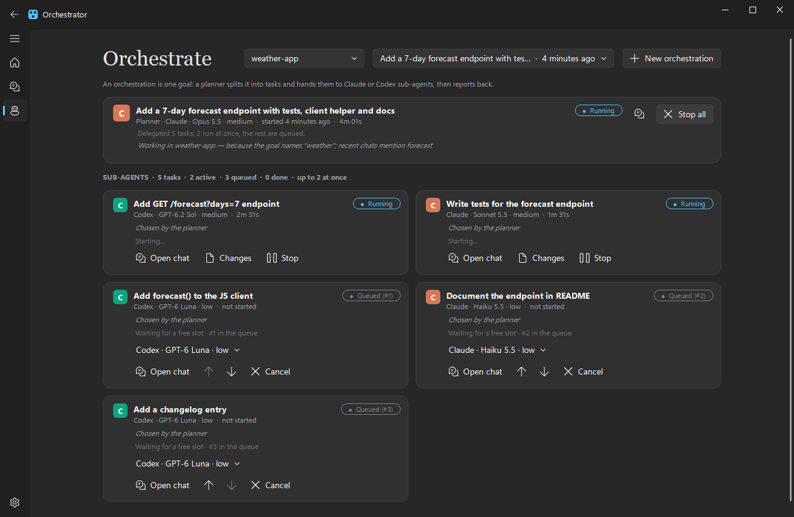

- **New orchestration** (was "New run"), with a one-line explanation of what an orchestration is. With no projects
  yet, the page explains that a project is a folder and has an **Add project folder** button right there.
- **Run up to N tasks at once** is a readable number field. Extra tasks show **Queued (#2)** on the board, in the
  order they will start; queued tasks can be moved earlier/later or cancelled.
- **Global limit** (Settings › Orchestrator › Agents running at once): orchestration tasks from every orchestration
  and scheduled chat runs share it; whatever does not fit waits and starts when a slot frees up.
- **Auto (pick from goal)** is the default project. The goal is matched against project names, folder paths and
  recent chat summaries; the composer shows "Working in: X — because …" with **Change**. When it is unclear the
  app asks (top 3 projects + Browse folder…) instead of guessing; with a single project it just uses it. The
  planner can call **find_projects** and delegate a task to another project (`project` argument).
- **Run now / Later ▾ (Run once later… / Repeat…)**: scheduled orchestrations are stored as schedules (listed on
  the Schedules page) and start through the same planner flow. Time chips: In 1 hour, In 5 hours (default),
  Tonight 9 PM, Tomorrow 8 AM, or a date and a 15-minute time list; the choice is read back in words.

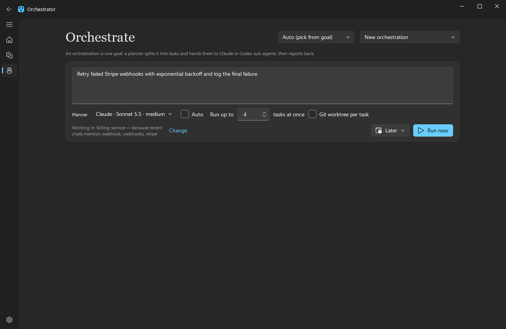

## Chat view

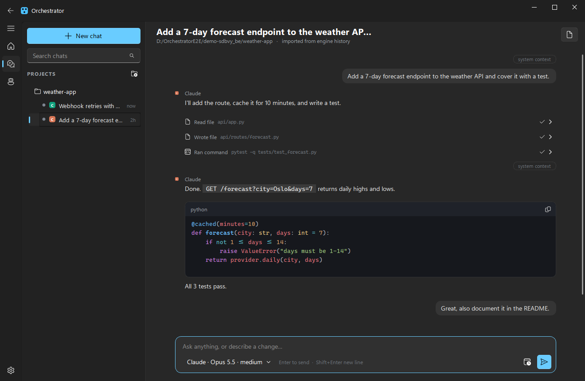

- Lighter layout: tighter spacing, soft user bubbles, tool calls as compact one-line rows (click to see output),
  paths shown relative to the chat's folder.
- The engine · model · effort picker sits in the composer, left of Send, so you always see what the next message
  will use. The header only has the title, folder, usage and the Changes button.
- Imported transcripts hide text the agent harness injected (`<system-reminder>`, `<command-name>`, `<wake>`
  envelopes and similar). The person's words inside an envelope are kept; hidden blocks show as a small
  "system context" chip (hover for what was hidden). The same text is kept out of titles, summaries and search,
  and titles saved before this are cleaned on startup.

## Fast startup

The window appears first and fills in after the first paint:

- Projects home renders right away from the local database; Chats, Orchestrate, Schedules and Settings are
  built one per event-loop turn just after the first paint (or immediately when you open one).
- The engine-history scan, scheduler, summaries, tray and shortcuts start in that same deferred pass. Until the
  first scan finishes, Projects home and the sidebar show a subtle "Loading sessions…" (skeleton cards if there is
  nothing cached yet).
- Heavy imports stay off the startup path: qfluentwidgets' image blur (numpy/scipy/PIL) loads only if used;
  APScheduler and the Claude SDK are preloaded on a background thread after the window is up.

Measure with `.venv\Scripts\python scripts\startup_bench.py [--target cmd|exe|both] [--runs 5] [--importtime]`.
It uses a private copy of your database (schedules off) and reports seconds from launch to the first painted
window and to fully ready (every page built and sessions refreshed from disk). On the dev machine:

| | first window (before → after) | fully ready (before → after) |
|---|---|---|
| `Orchestrator.cmd`, warm | 1.62 → 0.75 s | 1.83 → 1.43 s |
| `Orchestrator.cmd`, first run (no .pyc) | 3.05 → 0.86 s | 3.57 → 1.54 s |
| `Orchestrator.exe`, warm | 1.75 → 0.73 s | 2.01 → 1.35 s |
| `Orchestrator.exe`, first run after build | 2.38 → 1.98 s | 2.69 → 2.60 s |

## Usage limits

The title bar shows one pill per provider (Codex, Claude). Each pill has two thin bars: the 5-hour window on top
and the weekly window below. Every provider uses the same convention, **percent left**: bars fill with what is
left, and the number is the tightest window's percent left (for example "26% left"). Colors: green above 30% left,
amber 10–30%, red under 10%. Hover a pill to see "46% used · 54% left" and when each window resets.

Both sources report percent **used**, and the app shows 100 minus that:

- Codex `rate_limits.*.used_percent` is the share consumed. Codex's own `/status` shows the remaining share as
  "% left".
- Claude's rate-limit event `utilization` is documented as the "fraction of the rate limit consumed (0.0 - 1.0)".

A new provider fills in `used_percent` or `left_percent` on each `Window`. The UI reads only `remaining_pct`. Click it to open **Usage**, which shows
details, the source and a small history per window. Usage refreshes every 2 minutes and after each turn.

What is exact and what is an estimate:

- **Codex: exact.** Codex writes its rate limits (5-hour and weekly `used_percent`, `resets_at`) into its session
  logs after every turn. The app reads the newest one.
- **Claude: exact when the Claude Code CLI reports it.** During a turn the CLI sends a rate-limit event (status,
  utilization, reset time, window). It sends one only when something changes, often only for the window that is
  close to its limit. Windows without a report show an **estimate**: tokens used in that window, from the local
  Claude Code logs. That estimate has no percentage, because the logs do not include the plan size.

More providers (for example the Anthropic API) can be added by subclassing `UsageProvider` in
`orchestrator/core/usage.py` and calling `register()`.

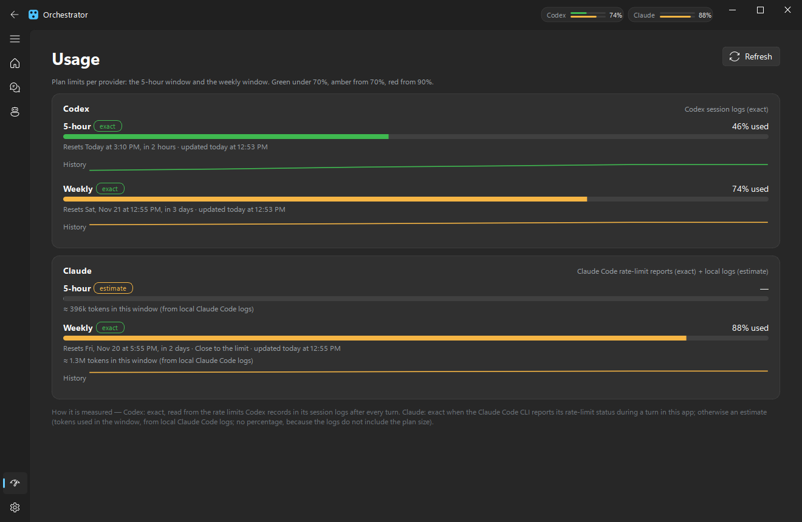
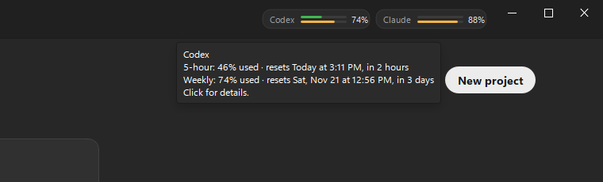

## Model preferences

Settings › Orchestrator › **Model preferences** is a table of rules. Each rule maps a task type and its keywords to
an engine, model and effort, with a priority (1 is checked first) and notes. The defaults are:

- Complex coding → Opus 5.5 · medium
- Large refactors → GPT-6.2 Sol · high
- Quick edits and summaries → Haiku 5.5 · low

How rules are used:

- When the planner or a sub-agent is picked automatically, the first enabled rule whose task type or a keyword
  appears in the text wins. The task card then says `Preference: <rule> → <model> · <effort> (matched "…")`.
- The planner prompt lists the rules first, then the routing guide.
- Rules whose model is disabled in Settings › Models are skipped, and the table warns about them.
- If you say "prefer X for Y" in a goal, or to the planner (which calls the `suggest_preference` tool), the
  Orchestrate page offers **Save rule**.

Image generation: Claude Code cannot generate images. Codex can, through its built-in `image_generation` feature
(checked with `codex features list`). A rule about images that points at Claude, or at Codex while that feature is
off, shows a warning.

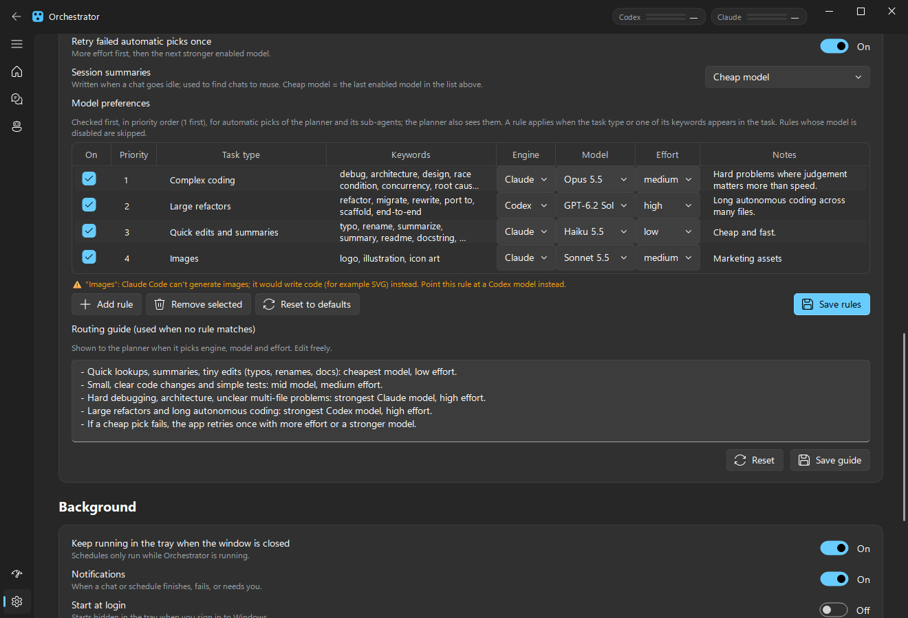
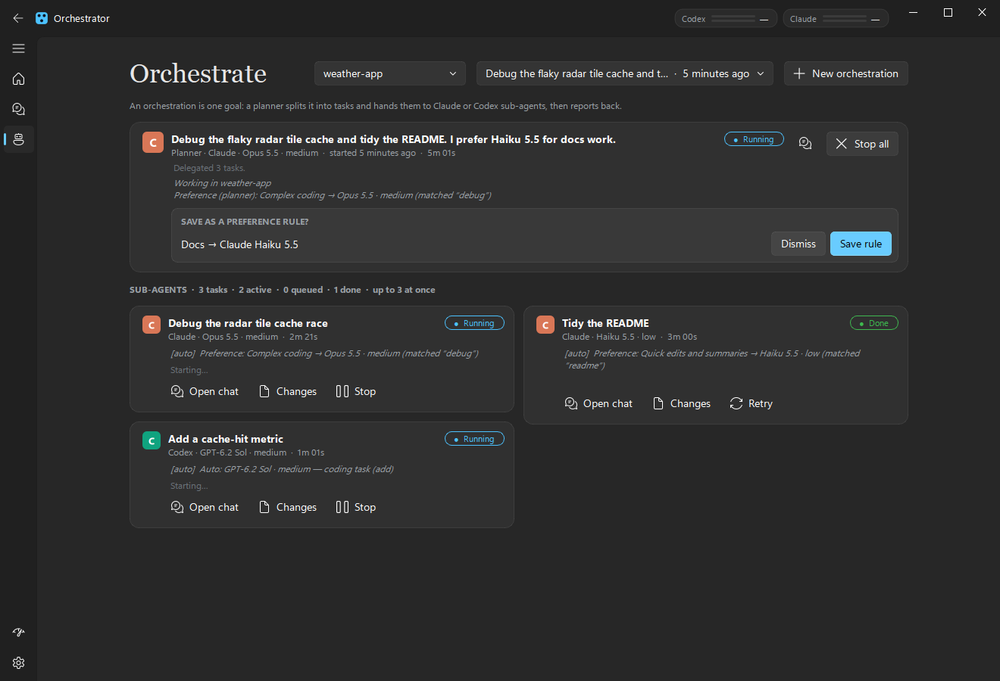

## Appearance

Settings › **Appearance** has these settings:

- Theme: Dark, Light or System (follows Windows).
- Accent color: five presets, or any color through Custom….
- Font for the whole app.
- UI font size: menus, buttons and labels. Default 10 pt.
- Chat font size: messages and the prompt box. Default 10.5 pt.
- Code font and code size: code blocks, inline code and tool output.
- Density: Comfortable or Compact. Compact gives tighter chat spacing and shorter sidebar rows.

Every change applies right away and is saved. A preview made of real chat widgets (a user message, an answer and a
code block) updates as you change things. Open chats re-render; a chat that is streaming re-renders when its turn
ends. Reset to defaults puts everything back.

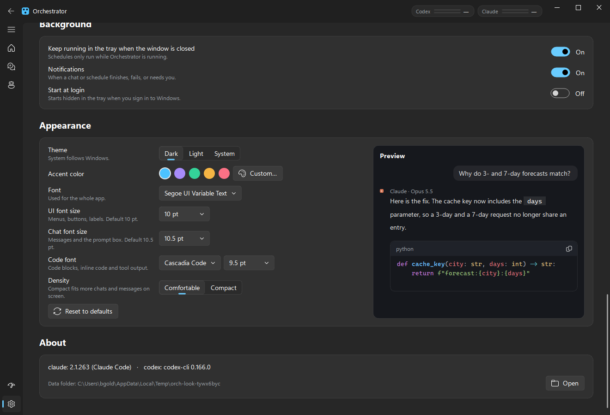
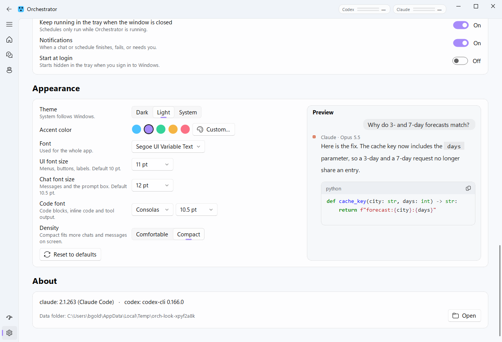

## App icon

The icon is a conductor node fanning out to three agent nodes, on a dark rounded tile in the app's sky accent.

- Source files: `assets/icon.svg`, plus pixel-tuned `assets/icon-small.svg` (20/24 px) and `assets/icon-tiny.svg`
  (16 px).
- `scripts/make_icon.py` renders PNGs from 16 to 256 px into `orchestrator/assets/icons/`. It also writes a
  multi-size `.ico`, which the exe (`orchestrator.spec`) and the installer use. `build.ps1` runs it.
- The icon is used for the app, every window, the title bar, the tray (with the running-jobs badge) and ordinary
  notifications.
- The app sets the Windows AppUserModelID `Orchestrator.App` before any window opens. The taskbar then shows this
  icon instead of Python's when the app runs from source (`Orchestrator.cmd` / `pythonw`).
- Settings › Background › Shortcuts: **Create desktop shortcut** and **Add to Start menu** write `.lnk` files with
  this icon and the same AppUserModelID, so pinning keeps working.
- When the Start menu shortcut exists, `Orchestrator.cmd` without arguments launches through it.

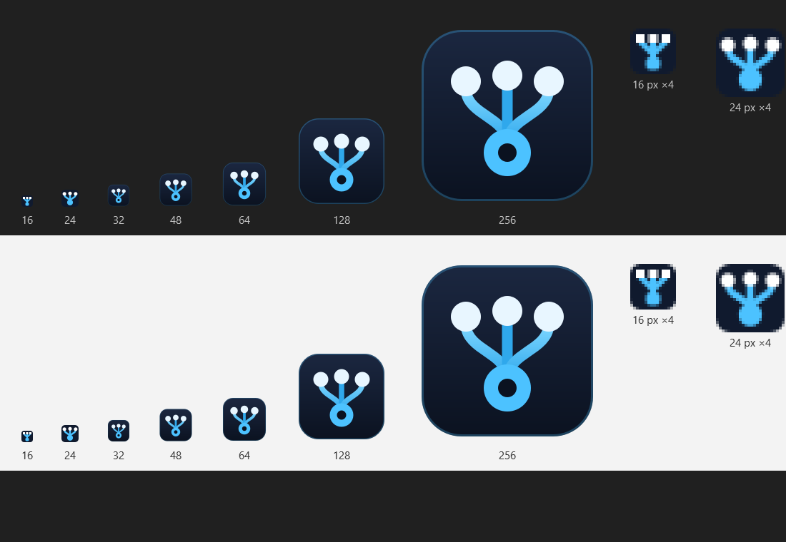

## Run

```
python -m venv .venv
.venv\Scripts\pip install -r requirements.txt
.venv\Scripts\python run.py
```

Or double-click `Orchestrator.cmd` (no console window).

Engines must be installed and signed in:

- Codex: `npm i -g @openai/codex`, then `codex login`.
- Claude: run `claude setup-token`, then paste the token in Settings › Accounts or set `CLAUDE_CODE_OAUTH_TOKEN`.
  The app looks for the token in this order: keyring, the process environment, then `HKCU\Environment`.

## Tests

```
.venv\Scripts\python -m pytest -q                                   # adapter parsing, storage, markdown
.venv\Scripts\python scripts\ui_smoke.py --engine codex --rich --shot docs\screenshots\m1.png
.venv\Scripts\python scripts\ui_smoke_m2.py real                    # import + resume + 2 chats at once
.venv\Scripts\python scripts\ui_smoke_m2.py demo --shot docs\screenshots\m2.png
.venv\Scripts\python scripts\ui_smoke_m3.py --shot docs\screenshots\m3.png   # real 1-minute schedule + run once
```

`ui_smoke.py` opens the real window and runs a live chat against a throwaway data folder: a new turn, a resume, and a tool turn.
